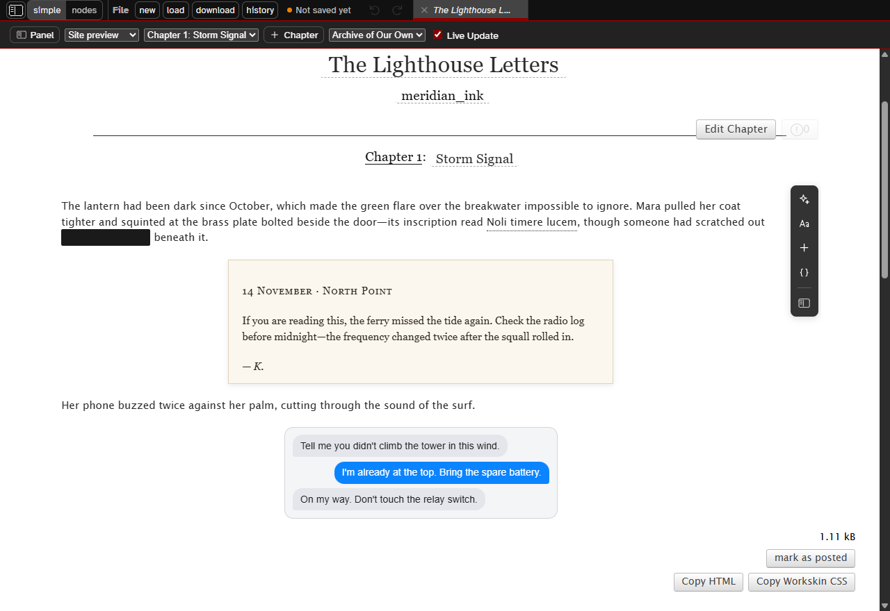
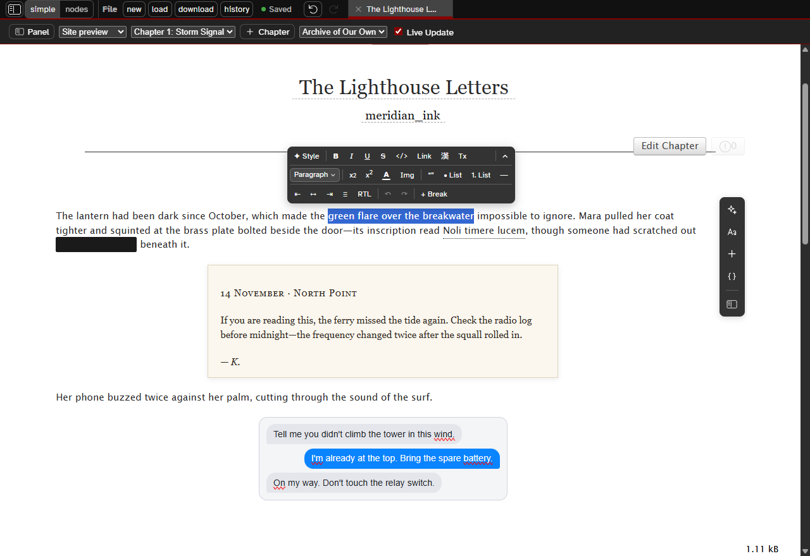
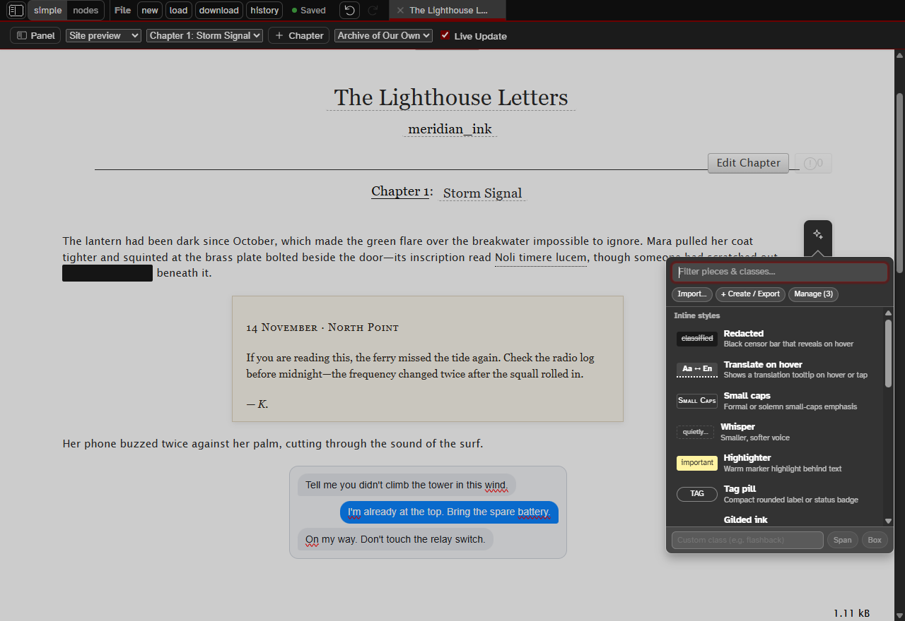
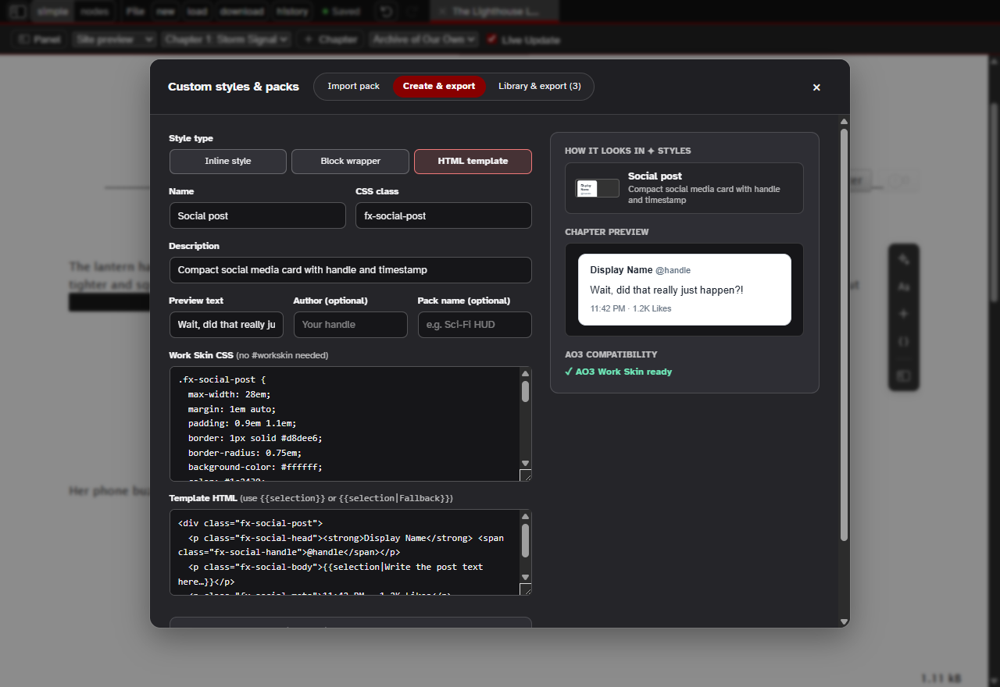
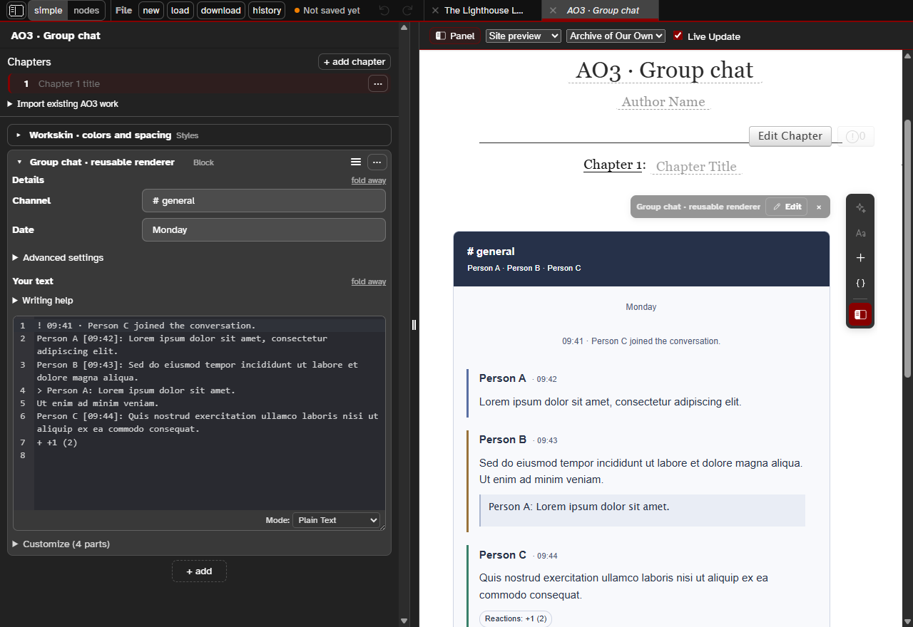
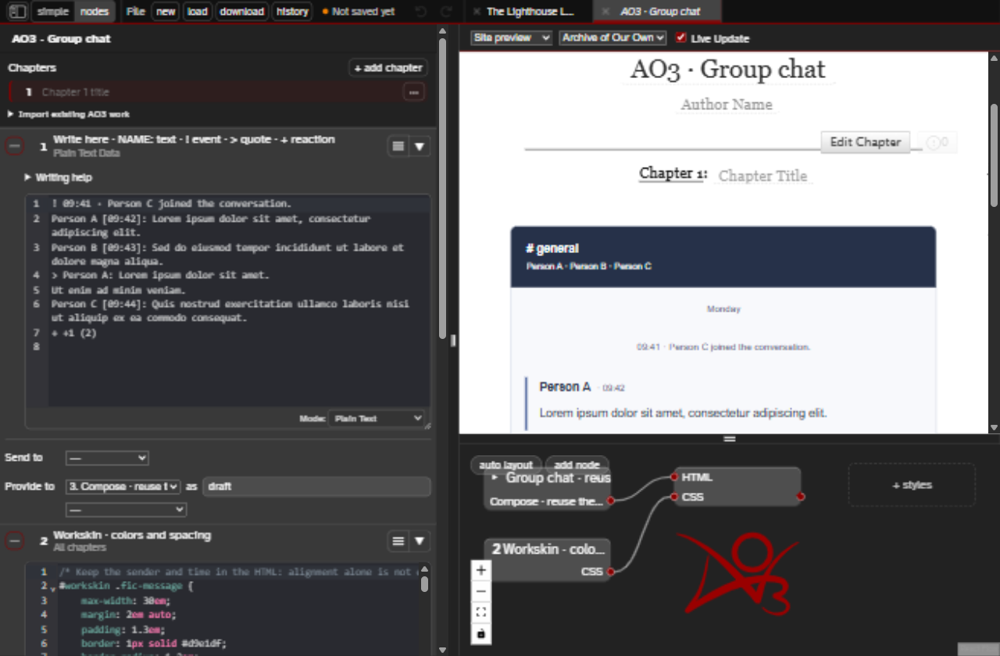

# eo3

**A visual, browser-based fic editor and HTML/CSS studio for Archive of Our Own.**

Write directly inside a live AO3 work page with WYSIWYG formatting, one-click AO3-safe effects, shareable style packs, and 14 ready-made workskin templates—then copy clean chapter HTML and validated Work Skin CSS in one click. Everything runs locally in your browser with no account or server required.

[**Open eo3**](https://eo3.dev/) · [**About & Workskin Gallery**](https://eo3.dev/about)



> Built upon the work of cpsdqs on [prechoster](https://github.com/cpsdqs/prechoster). Eggbug forever!

---

## Why eo3?

Formatting fancy fics on AO3 usually means wrestling with raw HTML, guessing which CSS properties AO3's sanitizer will silently strip, and copying snippets back and forth between tools.

eo3 fixes that at both ends:

- **Write visually, right on the page.** Simple view puts a chrome-less WYSIWYG editor directly inside a live AO3 mockup—edit the work title, author, chapter title, prose, and styled blocks in place.
- **What you see is what AO3 allows.** Preview and export both run through a port of AO3's real Ruby (`otwarchive`) HTML sanitizer and Work Skin CSS validator, parity-tested against AO3's actual codebase.
- **Zero-code effects, full power when you want it.** Start with one-click styles and templates; flip to **Nodes view** anytime for Svelte components, Sass/Less, custom pipelines, and reusable blocks.

---

## Live WYSIWYG Editing

### Write & format directly on the AO3 canvas

Highlight any text to bring up the floating formatting bar—and click its chevron to expand the full three-row toolbar with headings, bold/italic/underline/strikethrough, subscript & superscript, text colors & highlights, links, **ruby / furigana (`漢`)**, images, blockquotes, lists, alignment, RTL, and manual **chapter breaks (`+ Break`)**.



A compact floating **side rail** stays at the edge of the chapter for quick access to:

- **`✦` Styles** — apply built-in or imported AO3-safe CSS pieces and selection templates
- **`Aa` Format** — open the formatting toolbar from the cursor
- **`+` Insert** — add text sections, chapter styles, ready-made workskin blocks, or mirrored items from other chapters
- **`{ }` Work Skin CSS** — inspect or tweak the work's CSS without leaving the chapter
- **Panel toggle** — expand the left panel for multi-chapter navigation, raw HTML, and block settings

### One-click AO3-safe styles & interactive effects

Open **✦ Styles** to wrap text or paragraphs in tested, AO3-compatible styles. Applying any style automatically adds its CSS to your work's Work Skin—no `#workskin` prefixing or copy-pasting required.



| Category | Built-in pieces | What they do |
| --- | --- | --- |
| **Inline styles** | **Redacted**, **Translate on hover**, **Small caps**, **Whisper**, **Highlighter**, **Tag pill** | Style selected words inline. **Redacted** reveals on hover; **Translate on hover** shows a tooltip on desktop hover / mobile tap and degrades gracefully to `Original (Translation)` in EPUBs and when Creator's Style is off. |
| **Block wrappers** | **Callout box**, **Letter / parchment**, **Terminal / system**, **Epigraph**, **Journal entry** | Wrap paragraphs in styled `<div class="fx-...">` containers with live Work Skin preview. |
| **Selection templates** | **Text messages**, **Collapsible spoiler** | Turn highlighted lines (including `Name: message` lines) into alternating chat bubbles, or wrap text in an expandable `<details>` drawer. |
| **Your work's CSS** | Detected classes + custom class bar | Reuse any class already defined in your Work Skin, or apply any custom `<span>` / `<div>` class on the fly. |

### Shareable Style Packs (`.eo3styles.json`)

Want more styles—or want to design custom effects for less-technical writers to use? Click **Import…** or **+ Create / Export** right inside **✦ Styles** to open **Custom styles & packs**.



- **For writers (zero code):** Drop or paste a `.eo3styles.json` file to preview every style with its live-rendered swatch, name, description, creator credit, and AO3 compatibility check before adding it to **✦ Styles**.
- **For designers & coders:** Build **inline styles**, **block wrappers**, or **HTML snippet templates** (with `{{selection}}` / `{{selection|Fallback}}` slots) with live miniature swatch + full chapter previews and real-time AO3 Work Skin validation—then export a single style or bundle a whole pack as `.eo3styles.json` (or copy JSON to share).

Custom styles are saved in your browser's library across all works and are included automatically in full eo3 backups.

---

## 14 Ready-Made AO3 Workskin Templates

Open **Examples and Templates** in the sidebar (or **+ add → Blocks** in any chapter) to drop in complete, accessible AO3 workskin templates. Each template separates a **Details** form (dates, names, labels, plus **Advanced settings → Appearance** for text size, width, and typeface) from a plain-text writing box with built-in **Writing help**—and many regions can also be clicked and edited directly in the live preview.



| Conversations | Documents | Reading |
| --- | --- | --- |
| [Text messages](https://eo3.dev/?example=ao3-text-messages.toml) | [Personal letter](https://eo3.dev/?example=ao3-letter.toml) | [Poetry & lyrics](https://eo3.dev/?example=ao3-poetry.toml) |
| [Group chat](https://eo3.dev/?example=ao3-group-chat.toml) | [Journal entries](https://eo3.dev/?example=ao3-journal.toml) | [Chapter opening & scene breaks](https://eo3.dev/?example=ao3-chapter-opening.toml) |
| [Email correspondence](https://eo3.dev/?example=ao3-email.toml) | [Newspaper clipping](https://eo3.dev/?example=ao3-newspaper.toml) | [Linked footnotes](https://eo3.dev/?example=ao3-footnotes.toml) |
| [Social feed](https://eo3.dev/?example=ao3-social-thread.toml) | [Case file](https://eo3.dev/?example=ao3-case-file.toml) | [Collapsible extras](https://eo3.dev/?example=ao3-collapsible-notes.toml) |
| [Recording transcript](https://eo3.dev/?example=ao3-transcript.toml) | [Terminal log](https://eo3.dev/?example=ao3-terminal.toml) | |

Browse live styled vs. unstyled comparisons and download offline bundles in the [workskin gallery](https://eo3.dev/about#examples).

---

## Publishing to AO3 & Beyond

eo3 is built for multi-chapter works and real posting workflows—not just one-off snippets:

- **Exact AO3 sanitization & Work Skin validation:** Inline styles are automatically lifted into canonical, sorted `eo3-*` classes and merged into one Work Skin with `#workskin` scoping; chapter-specific CSS is scoped automatically to its chapters.
- **Multi-chapter works & mirroring:** Manage chapters in the panel, share Work Skin rules via **All chapters**, and **mirror** any text, style, or block across multiple chapters (editing it anywhere updates it everywhere, with its CSS emitted once).
- **Size meter & chapter splitting:** Tracks chapter size against AO3's 500,000-character limit and splits cleanly at top-level blocks—or right at your own `+ Break` (`<!-- eo3:split -->`) markers—while keeping both halves editable.
- **Posting tracker & Work Skin diffs:** Click **mark as posted** after copying a chapter to record its classes and Work Skin baseline. Later edits show exactly how many styles were added or removed, protect rules still used by already-posted chapters, and let you review and clean up unused styles.
- **Import existing AO3 works:** Paste an existing Work Skin and chapter HTML to bring an in-progress fic into eo3 without breaking rules on chapters you haven't imported yet.
- **Crossposting & custom sites:** Switch the preview/export target between **Archive of Our Own**, **wafrn** (parity-tested against wafrn's `sanitize-html` config), **Cohost** (legacy), or **custom sites** defined with declarative, no-code profiles (shared stylesheet, inline styles, `<style>` block, or plain HTML). Posting state is tracked independently per site.

---

## Full Power Under the Hood: Nodes View

Every eo3 work is a directed graph of modules. Simple view reads and rewrites that graph automatically (`src/linear.ts`), and you can switch between **simple** and **nodes** anytime in the toolbar.



Use **Nodes view** whenever you want to:

- Wire **HTML / TipTap rich text**, **CSS**, **Sass**, **Less**, **JavaScript**, **Svelte 3 / 4 / 5** components, **Settings** forms, uploaded files, and external URLs together with ordered sends and named side-inputs.
- Run transforms like **Style Inliner**, **SVG to backgrounds**, **SVGO**, and data/blob URL converters.
- Package any sub-graph into a reusable **block** (`.eo3group.json`) with a declarative Settings form—see [Authoring group settings](docs/group-settings.md)—and save it to **My groups** so writers can drop it into Simple view with one click.

---

## Saving, Version History & Backups

Everything runs 100% client-side in your browser; no server ever sees your drafts.

- **Automatic saving:** Works save continuously to browser storage (IndexedDB) as you edit, with a live status indicator in the toolbar and retry/download recovery if a write fails.
- **Opt-in Version History:** Click **history** (or the save indicator) and enable **Keep versions of this work** to snapshot active editing minutes (up to 120 versions / ~20 MiB, with full snapshots every 10 active minutes, word/chapter diff summaries, and undoable restores).
- **Whole-library Backups:** Use **Backups** in the sidebar to export all works, version history, **My groups**, custom **Styles**, and **custom sites** as a single JSON file—and import backups safely as copies without overwriting existing works.

> Browser storage can be cleared by the browser or OS; download periodic backups (or individual `.toml` work files) for anything you can't afford to lose.

---

## Development & Contributing

```sh
npm install
npm run dev        # start local dev server
npm run typecheck  # TypeScript check (tsc --noEmit)
npm test           # Vitest suite (AO3 & wafrn parity, document, targets, UI)
npm run build      # regenerate workskin docs, build dist/, and export gallery bundle
```

- Start with [AGENTS.md](AGENTS.md) for repo conventions and [docs/CODEMAP.md](docs/CODEMAP.md) for a map of every directory, feature, and test suite.
- Architecture and publishing design notes live in [docs/design/publishing-model.md](docs/design/publishing-model.md).
- To regenerate the 14 bundled workskin TOML documents from `assets/workskins`, run `node scripts/build-workskin-documents.mjs` followed by `node scripts/export-workskin-examples.mjs`.
- **Do not break saved module data interfaces**—existing user documents and backups depend on backwards compatibility.

### Browser support

Requires ES modules, `<dialog>`, and Web Workers (**Chrome 80+**, **Firefox 114+**, **Safari 15.4+**).
